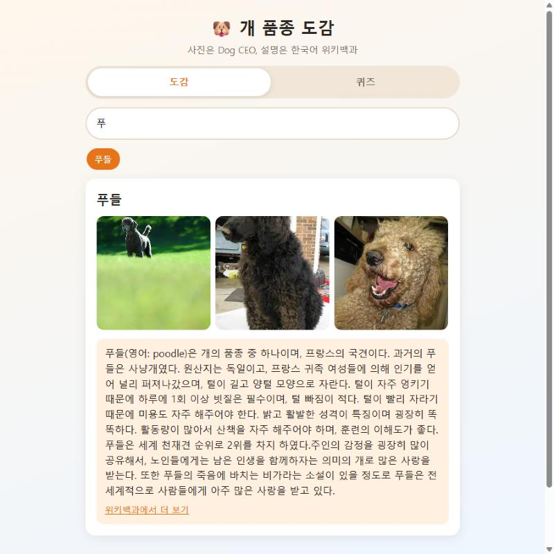
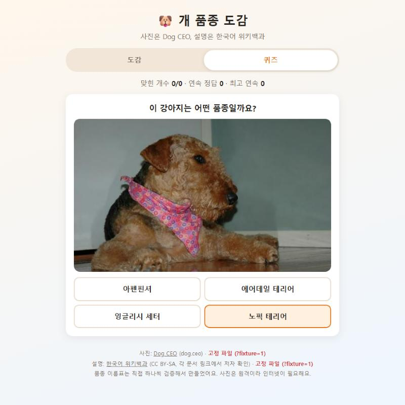
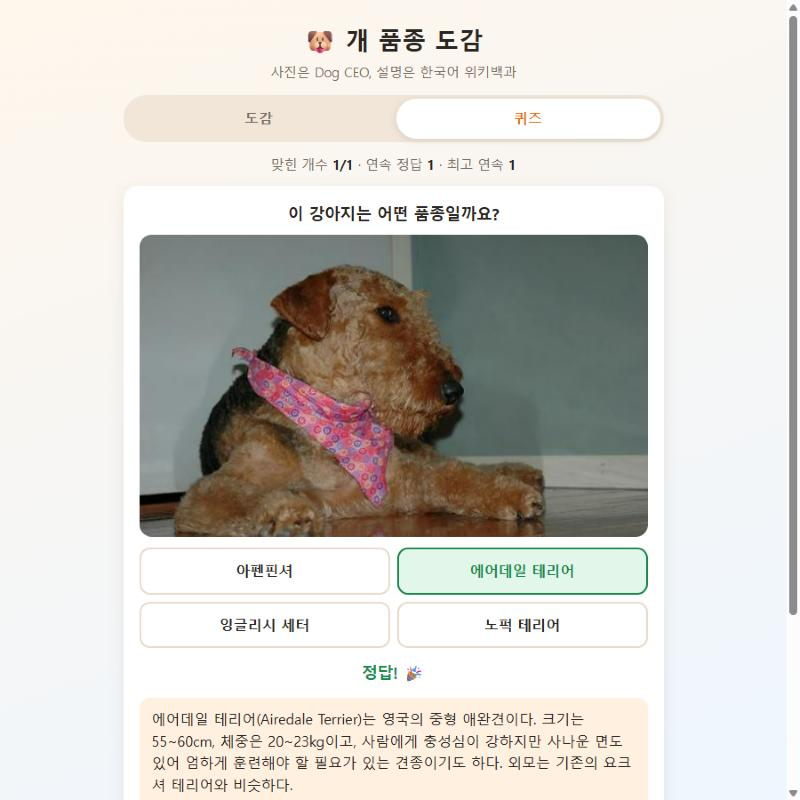
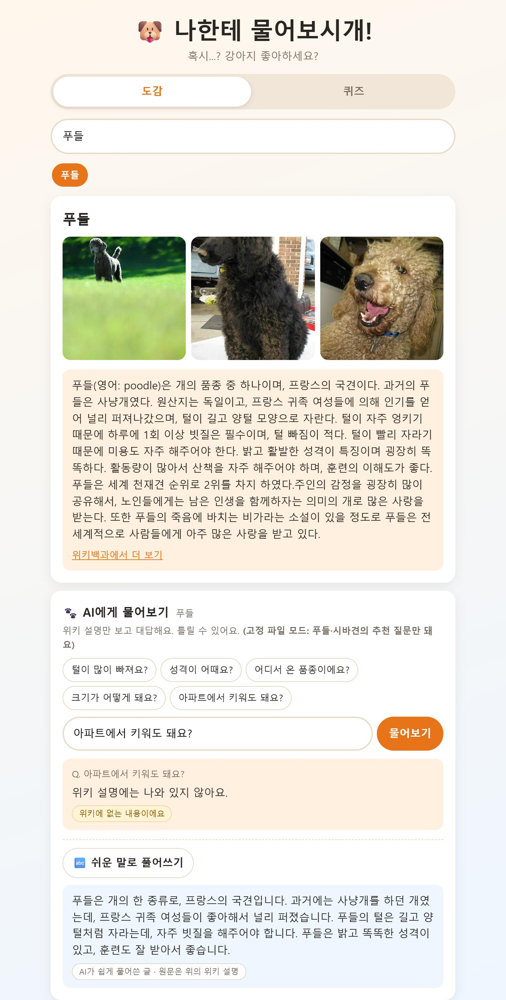
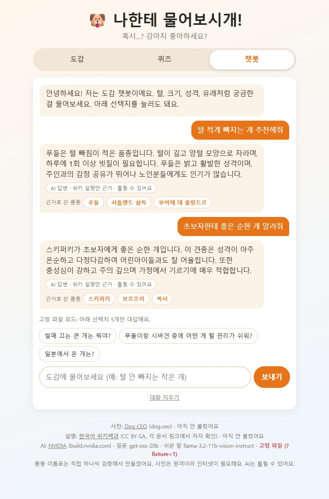

# 나한테 물어보시개!

강아지 품종 **도감 + 퀴즈 + AI 질문 챗봇**입니다. 사진은 [Dog CEO API](https://dog.ceo/dog-api/), 설명은 한국어 위키백과에서 가져옵니다.



| 퀴즈 | 정답 | AI 물어보기 | 챗봇 |
|---|---|---|---|
|  |  |  |  |

## 기능

- **도감**: 품종을 고르면 사진과 위키 요약을 보여 줍니다.
- **퀴즈**: 사진을 보고 품종 맞히기.
- **AI 물어보기 / 챗봇**: 품종에 대한 질문에 AI가 답합니다. 챗봇은 품종 설명을 임베딩해 질문과 가까운 품종 정보를 찾아 답변에 넣습니다.

## 구성

```
index.html, app.js, render.js, rules.js, api.js   화면과 규칙
server.py                 로컬 서버: 브라우저 대신 AI API(NVIDIA)를 호출, 키는 .env에서만 읽음
data/breeds.js            품종 목록
fixtures/                 저장해 둔 API 응답(오프라인·테스트용)
tools/                    fixtures·임베딩을 만드는 스크립트
```

AI 키가 브라우저 코드에 노출되지 않도록 서버(`server.py`)만 키를 읽습니다.
기획과 겪은 문제는 [기획_한장.md](기획_한장.md), [문제기록.md](문제기록.md)를 보세요.

## 실행

도감과 퀴즈만 보려면 정적 서버로 충분합니다. AI 기능에는 키가 필요합니다.

```bash
cp .env.example .env     # 열어서 본인 NVIDIA API 키를 넣으세요
python server.py
```

`.env`는 `.gitignore`에 들어 있어 저장소에 올라가지 않습니다.
